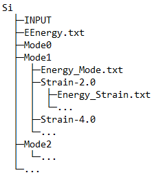

============
Get Started
============

Simplest way to run
===================

- Prepare the ``INPUT.e3rd`` file and the input files of your energy/stress provider
  (first-principles code or machine-learning force field)
- Enter the folder
- Run ``elastic3rd run``

The whole workflow is orchestrated by a single function,
``elastic3rd.elastic.elastic3(INPUT="INPUT.e3rd")``, which:

1. reads the input parameters and the lattice of the initial structure;
2. optionally geometry-optimizes the initial structure;
3. optionally adds a small atomic perturbation;
4. computes the reference energy/stress of the undeformed structure (``Mode0``);
5. applies each symmetry-adapted strain mode at each strain amplitude, deforming the
   lattice through the deformation gradient ``F = strain2deformgrad(eta)``;
6. delegates the energy/stress calculation to the selected provider;
7. fits the response (polynomial fitting) or differentiates it numerically, then solves
   the symmetry equations for the independent elastic constants of every requested order.

The results (second-, third-, ... order constants) are printed to the screen/log in GPa.

Inputs
======

The inputs for Elastic3rd can be divided into two parts. The first one is the
``INPUT.e3rd`` file, and the second is the input files for the energy/stress provider.

INPUT.e3rd
----------

The file is a plain text list of ``Key  value`` pairs (``#`` starts a comment);
JSON and YAML formats are also recognized from the file extension.
Unknown keys raise an error. All keys and their defaults:

=============  ============  ============================================================================
Parameter      Default       Comments
=============  ============  ============================================================================
BaseName       Si            Name of the result folder. For CASTEP it must equal the stem of the
                             .cell/.param files; for VASP it is any string; for the ML providers it is
                             the stem of the structure file (BaseName.cif, BaseName.poscar, ...)
CrystalType    C1            Elastic crystal class: isotropic/i, cubic1/c1, cubic2/c2, hexagonal1/h1,
                             hexagonal2/h2, rhombohedral1/r1, rhombohedral2/r2, tetragonal1/t1,
                             tetragonal2/t2, orthorhombic/o, monoclinic/m, triclinic/n (case-insensitive,
                             long or short names)
Ord            3             Order of the elastic constants (2, 3 or 4; 5 for i/c1/c2/t1/t2/o/m/n)
EnergyCode     CASTEP        Provider that computes energy/stress; Elastic3rd imports the module
                             elastic3rd.energy.<EnergyCode> (case-insensitive), see EnergyCodes page
EnergyRun      1             1 = built-in run command (CASTEP: RunCASTEP.bat/sh -np NP BaseName; VASP:
                             mpirun -np NP vasp_std). 0 = user defined, the command line is read from the
                             energyrun file next to the provider module
FlagSE         E             E = strain-energy method, S = strain-stress method
CalMode        W             W = whole (all symmetry-adapted modes), S = user-specific modes read from
                             the STRAINMODE file
GenSM          1             With CalMode=W: 1 = take built-in strain modes for this
                             CrystalType/Ord/method (a STRAINMODE file is written out and can be reused
                             with CalMode=S); 0 = generate modes programmatically
CoefMethod     fit           fit = polynomial fitting, num = numerical differentiation (num requires a
                             symmetric strain list and STEPS = 5)
Acc            4             Accuracy of the numerical-differentiation stencil (2/4/6/8); ignored by the
                             fitting method
MaxStrain      5.0           Maximum strain amplitude, in percent
MinStrain      -MaxStrain    Minimum strain amplitude, in percent
STEPS          5             Number of strain points per mode (at least 3)
StrainType     Uniform       Uniform = equidistant from MinStrain to MaxStrain; Cos... = cosine spacing.
                             A STRAINAMP file overrides these four parameters when present (see below)
NP             1             Number of cores passed to the provider run command
Geom           0             Geometry optimization of the initial structure before deformation: 0 = none;
                             1 = full cell+ion relaxation (G); 2 = variable-cell shape relaxation then
                             full relaxation (GS, G); 31/32 = same as 1/2 but stop after the optimization
                             (useful to prepare a relaxed structure only)
StableEst      1             Treatment of each deformed structure: 1 = relax ions at fixed cell for every
                             strain point, 0 = single-point calculation on the rigidly deformed lattice
AddPert        0             1 = add an atomic perturbation to the initial structure before the Mode0
                             calculation (helps symmetry-lowering relaxations converge)
PertMethod     random        Perturbation type: random or uniform (displacement ~2e-10)
Continue       0             1 = continue an interrupted run: existing Energy_*.txt / Stress_*.txt
                             results are re-read instead of recalculating
=============  ============  ============================================================================

A minimal example::

    BaseName        Si
    CrystalType     c1
    Ord             3
    EnergyCode      vasp
    FlagSE          E
    CalMode         W
    GenSM           1
    CoefMethod      fit
    MaxStrain       5.0
    STEPS           5
    NP              24
    Geom            0
    StableEst       1
    Continue        0

Strain modes
------------

For a given crystal class, elastic order and method, only a small number of
symmetrically independent deformation modes is needed to recover all independent
constants. With ``CalMode W`` these modes are either taken from the built-in library
(``GenSM 1``, written to a ``STRAINMODE`` file) or generated so that the coefficient
matrix of the requested order reaches full rank (``GenSM 0``).

Each mode is a Voigt 6-vector ``xx yy zz yz xz xy`` (engineering convention, in
``elastic3rd/symmetry/COEFS`` the built-in sets are stored per order and method),
so with ``CalMode S`` the user can supply his/her own ``STRAINMODE`` file, e.g. the
cubic set shipped in the ``examples`` folder::

    0 0 0 2 0 0
    0 0 0 0 2 0
    0 0 0 0 0 2
    1 0.5 0 0 0 0
    1 -0.5 0 0 0 0
    1 1 1 0 0 0

Strain amplitudes
-----------------

The amplitudes applied to every mode are built from ``MinStrain``, ``MaxStrain``,
``STEPS`` and ``StrainType``. If a file named ``STRAINAMP`` exists in the working
folder, it is loaded instead (one vector of amplitudes in percent, whitespace
separated) and overrides those four parameters. Numerical differentiation
(``CoefMethod num``) additionally requires a symmetric list, e.g.::

    -5 -2.5 0 2.5 5

Provider input files
--------------------

What the provider expects in the working folder:

- CASTEP: ``BaseName.cell`` and ``BaseName.param`` (plus ``RunCASTEP.bat`` on Windows or
  ``RunCASTEP.sh`` on Linux in the current folder). Details on the `CASTEP files`_.
- VASP: ``INCAR``, ``POSCAR``, ``KPOINTS``, ``POTCAR`` (plus ``mpirun`` and a compiled
  ``vasp_std`` in ``PATH``). Details on the `VASP files`_.
  For the strain-stress method set ``ISIF = 2`` so that stress is printed in OUTCAR.
- ABACUS: ``STRU``, ``KPT``, ``INPUT``.
- Quantum ESPRESSO: ``BaseName.scf`` (PWInput), results read from ``BaseName.out``
  (energy only).
- ML providers: a structure file readable by pymatgen (``BaseName.cif``,
  ``BaseName.poscar``, ``BaseName.json``, ``BaseName.yaml`` or a plain ``POSCAR``),
  optionally a ``settings.yaml`` to choose the model and optimizer.

.. _`CASTEP files`: http://www.tcm.phy.cam.ac.uk/castep/documentation/WebHelp/content/modules/castep/expcastepfileformats.htm
.. _`VASP files`: https://www.vasp.at/wiki/index.php/Category:Input_Files

Calculation
===========

Run everything with::

    elastic3rd run

or, equivalently, from a python script (handy on queue systems)::

    import elastic3rd.elastic
    elastic3rd.elastic.elastic3()

which can be launched as ``python runElastic3rd.py >> Result.txt``.

Using CASTEP
------------

Note: The CASTEP interface is tested with the CASTEP module of Materials Studio, but it
also works with standalone CASTEP. By default, the user should provide ``RunCASTEP.bat``
(Windows) or ``RunCASTEP.sh`` (Linux) in the current folder. Usually this file is located
in ``Materials_Studio_install_path\etc\CASTEP\bin``. Elastic3rd calls
``RunCASTEP.bat -np NP BaseName`` / ``./RunCASTEP.sh -np NP BaseName``; the energy is read
from ``BaseName.geom`` (or ``BaseName.castep``), together with the relaxed structures, so
ask for the appropriate ``.geom``/stress output in your ``.param`` file.

Using VASP
----------

For VASP, Elastic3rd runs ``mpirun -np NP vasp_std`` in each strain folder, so please
ensure that ``mpirun`` and ``vasp_std`` can be found in your ``PATH``. The energy is read
from ``OSZICAR`` and the stress from ``OUTCAR`` (the ``in kB`` block; requires
``ISIF = 2``). After a geometry optimization the ``CONTCAR`` is used as the new
``POSCAR``. The interface rewrites ``ISIF``/``NSW``/``IBRION`` automatically depending on
whether a relaxation or a single point is requested (see ``StableEst`` and ``Geom``).

To avoid maintaining INCAR/KPOINTS by hand, the ``vasp_pmg`` provider (based on pymatgen)
only requires a ``POSCAR``; then the energy is read from ``OUTCAR`` and the stress from
``vasprun.xml``.

Using machine-learning force fields
-----------------------------------

ML providers are executed in-process through ASE calculators: no run command and no
queue system are needed, and Elastic3rd only requires the structure file. See
:doc:`EnergyCodes` for the list of supported models and the ``settings.yaml`` options.

Using other first-principles codes
----------------------------------

If you want to use another code to calculate the energy or stress, create a python file
named after the code (lowercase, e.g. ``qe.py``) under ``elastic3rd/energy/`` that
implements the provider API:

- ``get_base_vec(BaseName)``: read the lattice vectors from the code's input file
- ``write_base_vec(BaseName, BaseVec)``: write the (deformed) lattice vectors back
- ``run(NP, BaseName)``: return the shell string that runs one calculation
- ``get_energy(BaseName)``: read the total energy (eV) from the code's output
- ``get_stress(BaseName)``: read the stress (GPa, Voigt) from the code's output —
  required for the strain-stress method
- ``copy_files(BaseName, Path)`` / ``rem_files(BaseName)``: stage and clean working files
- ``update_structure(BaseName, Path)``: write the relaxed structure back
- ``update_input_for_geomopt(BaseName, FlagEG, KeepSym)``: switch the code's input
  between single point (``EO``), ion relaxation (``E``) and cell relaxation (``G``/``GS``)
- ``add_perturbation(BaseName, tor, PertMethod)``: displace the atoms

Then select it in ``INPUT.e3rd`` with, e.g., ``EnergyCode  QE``.

Post
====

The SOECs, TOECs, ... (up to the order actually solved) are printed in the log on the
screen once the calculation finished.

To take higher-order effects into account (i.e. refit the collected energy/stress data
without running any calculation), use the ``elastic3rd post`` command in the folder where
the job was submitted::

    elastic3rd post -n 4        # recover 4th-order constants from the existing data

For the full option list, run ``elastic3rd post -h``. See :doc:`examples` for a worked
example.

Alternatively, the separate numerical-differentiation method (PRL 121, 216001), where
each Cij is obtained component by component from dedicated strain-stress finite
differences, is available as its own command::

    elastic3rd nd -s 4          # SOECs+TOECs with 4% strain, all independent constants

It reads ``BaseName``/``CrystalType``/``Ord``/``NP``/``Acc`` from ``INPUT.e3rd`` (order 2
or 3, accuracy 2 or 4) and writes the results to the ``BaseName-E3rd-ND`` folder. Both
stress-capable first-principles providers and the machine-learning providers can be
used; for the latter the code forces a single-point evaluation of each rigidly deformed
lattice (no relaxation). See :doc:`examples` for the full option list.

Outputs
=======

The structure of outputs
------------------------
All the outputs are stored in the folder named ``BaseName``, as set in the INPUT file.
The structure of the results:

|FileStructure|

Output files
------------
This section gives an explanation for each file generated by Elastic3rd.

==================  =================================================================================
File name           Comments
==================  =================================================================================
INPUT.e3rd          A backup of the INPUT file
EEnergy.txt         The energy (strain-energy method) or stress (strain-stress method) of every
                    strain amplitude (rows) for each strain mode (columns)
Energy_Strain.txt   The response of a single strain point, energy in several units
                    (eV, Hartree, kJ/mol, kcal/mol); Stress_Strain.txt analog for stress
Energy_Mode.txt     The energies of one strain mode as a function of strain;
                    Stress_Mode.txt analog for stress
STRAINMODE          A copy of the strain modes actually used
STRAINAMP           A copy of the strain amplitudes actually used (when provided)
==================  =================================================================================

=======  ========================================================
Folders  Comments
=======  ========================================================
Mode0    Result of the undeformed (reference) structure
ModeN    Results of the Nth strain mode
StrainN  Within each mode, one folder per strain amplitude
Geom     (When ``Geom`` is set) the geometry-optimization run
=======  ========================================================

Note: here N is an integer.

Units
-----

- Energies are collected in eV per cell; ``EEnergy.txt`` and the log also report Hartree,
  kJ/mol and kcal/mol.
- Stresses are read/converted to GPa.
- The reported elastic constants (C2, C3, ...) are in GPa.

Log file
--------

By default, the log is printed to the screen, and it can be saved by re-direction
(``elastic3rd run >> Result.txt``). It can be divided into five parts.

- Part1: the logo and citation part

.. code::

    +=============================================================+
    | EEEEE L       A   SSSSS TTTTT IIIII CCCCC 33333 RRRRR DDD   |
    | E     L      A A  S       T     I   C         3 R   R D  D  |
    | EEEE  L     A   A SSSSS   T     I   C      3333 RRRRR D   D |
    | E     L     AAAAA     S   T     I   C         3 R  R  D  D  |
    | EEEEE LLLLL A   A SSSSS   T   IIIII CCCCC 33333 R   R DDD   |
    +-------------------------------------------------------------+
    |             Version: ELASTIC3PY  version 7.0.2              |
    |                Date: 2026-10-15                             |
    |              Author: Liao Mingqing                          |
    |              E_mail: liaomq1900127@163.com                  |
    |     FGMS @ Harbin Institute of Technology(HIT)              |
    |    URL:https://github.com/hitliaomq/ELASTIC3rd              |
    +=============================================================+

- Part2: the summary of the input parameters

- Part3: the result of the initial (and, if requested, optimized) structure:

.. code::

    ====================Crystal Structure====================
    BaseVec:
         5.4647128853     0.0000000210     -0.0000000454
         -0.0000000000     5.4647128382     -0.0000000222
         0.0000000000     0.0000000000     5.4647129020
    Lattice Parameter:
        a         b         c      alpha   beta    gamma
    5.464713  5.464713  5.464713  90.000  90.000  90.000
    Volume : 163.193194972

    Energy of undeformed structure:
           eV             Hartree            kJ/mol            kcal/mol
    -858.6574758785  -31.5550611783  -82847.8330874176  -19801.1085892908

- Part4: the results of each strain of each strain mode

.. code::

    ==================Deformed Crystal========================
    ----------------------------------------------------------
    Start calculating Mode 1
    Start calculating Strain -5.0 in Mode 1
    BaseVec:
         ...
    Energy:
           eV             Hartree            kJ/mol            kcal/mol
    -858.0935122952  -31.5343359114  -82793.4188860286  -19788.1032822074
    End of Strain -5.0 in Mode 1

                          ...

- Part5: the post-processing part, i.e. the symmetry equations and the elastic
  constants:

.. code::

    ==================Post Processing========================
    [11 12 44]
    [153.05111127  65.0171889   73.22518077]
    [111 112 123 144 155 456]
    [-703.9889652  -435.4462948   -88.79485798   71.7458725  -257.35598339
      -51.04707056]
    ========================!!!END!!!=========================

The first index list/line pair gives the second-order constants (here cubic: C11, C12,
C44, in GPa), the second one the third-order constants.
