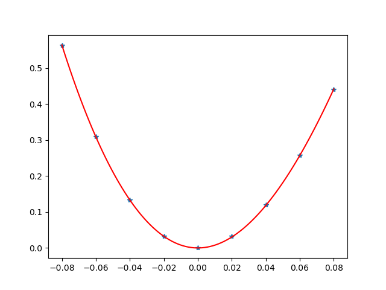

========
Examples
========

Help on the `elastic3rd` command
--------------------------------

There are two commands to submit jobs or do post processing.

- `elastic3rd run` command

.. code::

    ELASTIC3RD version: 7.0.2
    Copyright © FGMS@HIT & JUST

    usage: elastic3rd run [-h] [-i INPUT]

    optional arguments:
      -h, --help            show this help message and exit
      -i INPUT, --input INPUT
                            The input file for Elastic3rd. Default: 'INPUT.e3rd'

- `elastic3rd post` command

.. code::

    ELASTIC3RD version: 7.0.2
    Copyright © FGMS@HIT & JUST

    usage: elastic3rd post [-h] [-n N] [-i INPUT] [-sm STRAINMODE] [-fig FIG] [-v VOLUME] [-e ENERGY]

    optional arguments:
      -h, --help            show this help message and exit
      -n N, --n N           The order of elastic constant taken into consideration in the post
                            process. Default: 3
      -i INPUT, --input INPUT
                            The input file for Elastic3rd. Default: 'INPUT.e3rd'
      -sm STRAINMODE, --strainmode STRAINMODE
                            The filename of strainmodes. Default: 'STRAINMODE'
      -fig FIG, --fig FIG   Show the fitting fig. Default: 0
      -v VOLUME, --volume VOLUME
                            The volume of initial structure (only needed for the strain-energy
                            method without a structure file at hand). Default: derived from the
                            structure
      -e ENERGY, --energy ENERGY
                            The file of the energy/stress result. It will try to find it in the
                            current folder or in the BaseName folder. Default: 'EEnergy.txt'

- `elastic3rd nd` command (separate numerical differentiation, PRL 121, 216001)

.. code::

    ELASTIC3RD version: 7.0.2
    Copyright © FGMS@HIT & JUST

    usage: elastic3rd nd [-h] [-i INPUT] [-n N] [-s STRAIN [STRAIN ...]] [-a ACC] [--np NP]

    optional arguments:
      -h, --help            show this help message and exit
      -i INPUT, --input INPUT
                            The input file for Elastic3rd. Default: 'INPUT.e3rd'
      -n N, --n N           The order of elastic constants, 2 or 3. Default: the Ord in the input file
      -s STRAIN [STRAIN ...], --strain STRAIN [STRAIN ...]
                            The strain amplitudes, in unit of %. Multiple values give a mean over
                            them. Default: the MaxStrain in the input file
      -a ACC, --acc ACC     The accuracy of the differentiation, 2 or 4. Default: the Acc in the
                            input file
      --np NP               The number of cores used in the energy/stress calculation. Default:
                            the NP in the input file

This command runs the component-wise numerical-differentiation scheme on the
strain-stress response: every independent Cij is obtained from its own dedicated set of
strain modes (Eq. 6-8 of the PRL), instead of fitting all modes together. The results are
written to the folder ``BaseName-E3rd-ND`` (``EC.json`` keeps every estimate per strain
amplitude, ``EC_ave.json`` the average), and the averaged constants (GPa) are printed
when the run completes. It works with the first-principles providers that return stress
(``vasp``, ``castep``, ``abacus``) and with the machine-learning providers: for the
latter, ``flageg`` is forced to ``EO``, i.e. the stress of each rigidly deformed lattice
is evaluated in-process at a single point without any relaxation, exactly as required by
the method.

Submit jobs
-----------

There are several examples in the `examples
<https://github.com/hitliaomq/ELASTIC3rd/tree/master/examples>`_ folder.

For Si and C, both VASP and CASTEP input files are prepared in the folder, and for Mg,
only CASTEP input file is prepared. For the ABACUS/ML setups used in the tests, look at
the `test <https://github.com/hitliaomq/ELASTIC3rd/tree/master/test>`_ folder.

The user can run these examples by following steps

1.  For copy right, the author can't provide the RunCASTEP.bat or RunCASTEP.sh (for CASTEP) and POTCAR (for VASP) files. The user should provide these file in the current folder.

- For CASTEP, the user should copy `RunCASTEP.bat` or `RunCASTEP.sh` in their Materils Studio installation folder.

- For VASP, the user should provide the `POTCAR` file

2. Submit the job

There are several ways to submit the job.

- Using `elastic3rd run` command.

- Using the `runElastic3rd.py` (in `examples` folder) script by running `python runElastic3rd.py`. If the user want to save the log into file, please run `python runElastic3rd.py >> Result.txt`

- Submit jobs in queue system. If the user want to run Elastic3rd in queue system, the following is an example. Please note that it assume the python and vasp is exists in the `PATH`

.. code::

    #PBS -l nodes=1:ppn=24
    #PBS -l walltime=48:00:00
    #PBS -l pmem=8gb
    #PBS -A open
    #PBS -j oe

    cd $PBS_O_WORKDIR
     
    python runElastic3rd.py

Worked example: cubic Si with VASP, strain-energy, TOECs
---------------------------------------------------------

Folder layout before running::

    Si/
      INCAR  KPOINTS  POSCAR  POTCAR
      INPUT.e3rd

``INPUT.e3rd``::

    BaseName        Si
    CrystalType     c1
    Ord             3
    EnergyCode      vasp
    FlagSE          E
    CalMode         W
    GenSM           1
    CoefMethod      fit
    MaxStrain       5.0
    STEPS           5
    NP              24
    Geom            0
    StableEst       1
    Continue        0

Make sure ``ISIF = 2`` if you later switch to the stress method; for the energy method
any ``ISIF`` giving the total energy is fine. Run::

    elastic3rd run

The code creates the six built-in cubic strain modes (``STRAINMODE``), one folder per
mode and strain under ``Si/``, and finally prints the SOECs ``[C11, C12, C44]`` and
TOECs ``[C111, C112, C123, C144, C155, C456]`` in GPa.

Worked example: tetragonal oxide with CASTEP, strain-stress, SOECs+TOECs
-------------------------------------------------------------------------

This is the ``examples`` folder setup (a commented reference ``INPUT.e3rd`` is shipped
with the source)::

    BaseName        C
    CalMode         W
    GenSM           1
    FlagSE          S
    CoefMethod      Fit
    Continue        1
    CrystalType     T1
    Ord             2
    EnergyCode      castep
    EnergyRun       1
    MaxStrain       1.00
    MinStrain       -1.00
    STEPS           5
    Acc             4
    NP              1

Provide ``C.cell``, ``C.param`` (request the ``.geom`` output with stresses) and
``RunCASTEP.sh``/``RunCASTEP.bat``, then run ``elastic3rd run``. With ``FlagSE S`` the
stress response is fitted instead of the energy, which for low symmetry needs far fewer
modes.

Worked example: machine-learning force field (MACE) quick check
----------------------------------------------------------------

Prepare the structure and settings::

    Cu/
      Cu.cif
      INPUT.e3rd
      settings.yaml

``INPUT.e3rd``::

    BaseName        Cu
    CrystalType     c1
    Ord             3
    EnergyCode      mace
    FlagSE          E
    CalMode         W
    GenSM           1
    CoefMethod      fit
    MaxStrain       5.0
    STEPS           5
    StableEst       1

``settings.yaml``::

    model: mace-matpes-pbe-0
    device: cuda
    optimizer: FIRE
    ase_filter: ExpCellFilter
    steps: 400

Run ``elastic3rd run`` — the relaxations and single points are performed in-process by
the MACE calculator, no queue submission. The same pattern works for ``chgnet``,
``matgl`` (set e.g. ``model: M3GNet-MP-2021.2.8-PES``), ``sevenn``, ``mattersim``,
``orb``, ``grace``, ``tace``, ``matris``, ``nequip``, ``dpmd`` and ``alphanet``.

Bundled example folders
-----------------------

In addition to the older Si/C/Mg setups, the `examples
<https://github.com/hitliaomq/ELASTIC3rd/tree/master/examples>`_ folder ships three
complete worked setups.

``vasp-Diamond-differentMethods`` (cubic diamond, VASP, four methods side by side)
    One input folder with four sub-folders, each a self-contained run of the same
    structure (``POSCAR``), ``INCAR``/``KPOINTS`` files (**Note:** ``POTCAR`` file 
    is required to run the examples) and a user-provided
    ``STRAINMODE`` file (six modes for the cubic class: ``1 0 0 0 0 0``, ``1 1 0 0 0 0``,
    ``1 0 0 2 0 0``, ...):

    - ``Ord2``: second order only (``Ord 2``, ``FlagSE S``, ``MaxStrain 1``, 7 points)
    - ``SEM``: strain-energy method (``FlagSE E``, ``Ord 3``, ``MaxStrain 6``, 13 points)
    - ``SSM``: strain-stress method (``FlagSE S``, same strain grid as ``SEM``)
    - ``ND``: the separate numerical-differentiation workflow, run with
      ``elastic3rd nd`` (``MaxStrain 4``)

    All of them set ``CrystalType c1``, ``CalMode S`` (built-in modes are replaced by the
    shipped ``STRAINMODE``), ``Geom 1`` (the equilibrium structure is relaxed first) and
    ``Continue 1``, so an interrupted run can simply be restarted. The comparison of the
    three recovery schemes on this data, including the higher-order effect on the TOECs
    of diamond, is the subject of M. Liao, Y. Liu, Y. Wang et al., Revisiting the
    third-order elastic constants of diamond: the higher-order effect, Diamond Relat.
    Mater. 117 (2021) 108490, doi:10.1016/j.diamond.2021.108490.

``ML-Diamond`` (cubic diamond, all machine-learning providers)
    Eleven sub-folders (``mace``, ``matgl``, ``sevenn``, ``mattersim``, ``orb``,
    ``grace``, ``nequip``, ``dpa``, ``alphanet``, ``tace``, ``matris``) with identical
    ``INPUT.e3rd`` files except for the ``EnergyCode`` key (the ``dpa`` folder uses the
    provider name ``dpmd``). The setup mirrors the VASP strain-stress run above
    (``FlagSE S``, ``CalMode S`` with a shipped ``STRAINMODE``, ``CrystalType c1``,
    ``Ord 3``, ``MaxStrain 6``, 13 points): the energy/stress of every deformed lattice
    is computed in-process by the corresponding ASE calculator, so a full TOEC pipeline
    per model runs on a workstation. Drop a ``settings.yaml`` (model, device, optimizer)
    into a sub-folder to select the model; see :doc:`EnergyCodes`.

``abacus-Mo`` (molybdenum, ABACUS)
    The ``E3rd`` sub-folder holds the Elastic3rd input (``INPUT.e3rd`` with
    ``EnergyCode abacus``, ``BaseName Mo``, ``CrystalType c1``, ``Ord 3``, ``FlagSE S``,
    ``CalMode S``, ``GenSM 0`` with a user ``STRAINMODE`` file, symmetric grid from
    ``MinStrain -5`` to ``MaxStrain 5``, 11 points, ``Geom 1``), while the ABACUS inputs
    (``STRU``, ``KPT``, ``INPUT``) sit in the parent folder. The provider drives
    ``abacuspy`` and reads the results from ``abacus.json``; see :doc:`EnergyCodes` for
    the required files.

Post
----

There are several ways to do the post processing.

- Using `elastic3rd post` command

Assume that the current folder is the folder where the job has been submitted. When
enter the current folder, the user can do the post process by `elastic3rd post` to get
the SOECs and TOECs. For more options, please run `elastic3rd post -h`.

For test, the user can run elastic3rd post in the `example/Si/CASTEP` folder directly. It should print the following lines in the screen.

.. code::

    ELASTIC3RD version: 7.0.2
    Copyright © FGMS@HIT & JUST

    BaseVec:
         5.4647128853     0.0000000210     -0.0000000454
         -0.0000000000     5.4647128382     -0.0000000222
         0.0000000000     0.0000000000     5.4647129020
    Lattice Parameter:
        a         b         c      alpha   beta    gamma
    5.464713  5.464713  5.464713  90.000  90.000  90.000
    Volume : 163.1931949715094

    [11 12 44]
    [153.05111127  65.0171889   73.22518077]
    [111 112 123 144 155 456]
    [-703.9889652  -435.4462948   -88.79485798   71.7458725  -257.35598339
      -51.04707056]

- Higher-order effect and figures

Run `elastic3rd post -n 4 -fig 1` to include the fourth-order term when recovering the
constants and to show the fitting figures of every strain mode. The higher-order-effect
treatment is documented in M. Liao, Y. Liu, Y. Wang et al., Revisiting the third-order
elastic constants of diamond: the higher-order effect, Diamond Relat. Mater. 117 (2021)
108490, doi:10.1016/j.diamond.2021.108490:

|FittingFig|

- By calling the `post`, `post_single` or `post_mode` functions from `elastic3rd.post.post`

.. code::

    import elastic3rd.post.post2 as espost2
    C, Cerr = espost2.post_single(x, E, StrainIn, CoefMethod='fit', V0=V0,
                                  Flag_Ord=4, INPUT='INPUT.e3rd', flag_low=0)

where ``x`` are the strain amplitudes (fraction), ``E`` the energy densities and
``StrainIn`` the strain modes; ``Flag_Ord`` may be set up to 9.
